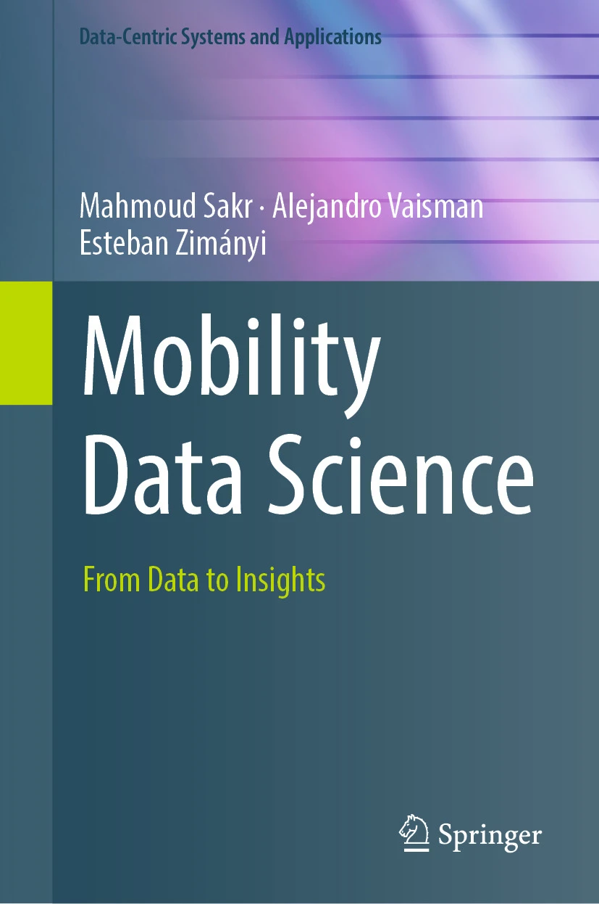

## Mobility Data Science: In-Memory, Large-Scale and Stream Processing
### Leticia Gómez, Alejandro Vaisman, Esteban Zimányi

This is the companion repository of the book "[Mobility Data Science: In-Memory, Large-Scale and Stream Processing](https://link.springer.com/book/10.1007/978-3-031-82636-8)" published by Springer in 2026. It contains the datasets used in the book alongside with the scripts allowing you to input these datasets in PostgreSQL and reproduce the examples and exercises in the book.

This repository is still IN CONSTRUCTION and we will improved it little by little. We welcome the contributions from the community to make this repository better.
