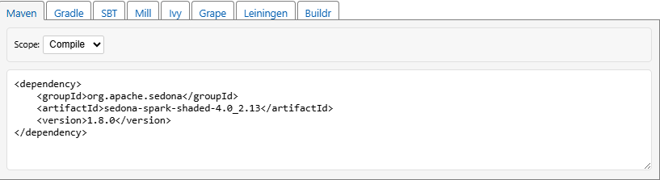

## Mobility Data Science: From Edge to Cloud Processing
### Alejandro Vaisman, Esteban Zimányi, with contributions by Leticia Gómez

### Chapter 8: Large-Scale Mobility Databases

This is the companion website of the book published by Springer.
It contains the datasets used in the book alongside with the scripts
allowing you to input these datasets in the various tools and reproduce the
examples and exercises in the book.

## PROVISORIO  ##

To run Spark applications we assume that Java 21 (download the zip version which does not require any installation from https://www.azul.com/downloads) and Apache Spark 4.0.1 (download spark-4.0.1-bin-hadoop3.tgz file from https://spark.apache.org/downloads.html) files have been downloaded. Unzip the files (sudo unzip zulu21.46.19-ca-jdk21.0.9-linux_x64.zip and sudo tar xvfz spark-4.0.1-bin-hadoop3.tgz) and configure the following environment variables.

$ mkdir /software
$ cd /software
$ export JAVA_HOME=/software/zulu21.46.19-ca-jdk21.0.9-linux_x64
$ export SPARK_HOME=/software/spark-4.0.1-bin-hadoop3
$ export PATH=$JAVA_HOME/bin:$SPARK_HOME/bin:$PATH

Verify that the applications are accessible:
$ javac  -version
$ java   -version
$ spark-submit

Apache Sedona is an external library that enables Spark with spatial funcionalities. 

To include an external Maven JAR in your Spark-SQL session, we can use the "--packages" parameter. 
The parameter format should be groupId:artifactId:version. The information of the library can be find out in Maven Repository. We use the last Apache Sedona version:
https://mvnrepository.com/artifact/org.apache.sedona/sedona-spark-shaded-4.0_2.13/1.8.0

The package parameter should be: org.apache.sedona:sedona-spark-shaded-4.0_2.13:1.8.0

Finally, we can run sparq-sql with Sedona (run spark-sql in a different directory containing the csv files because some extra files and directories are created and we do not want to consider theses data)

$ /software

Option 1:
$ spark-sql --packages org.apache.sedona:sedona-spark-shaded-4.0_2.13:1.8.0   --conf spark.serializer=org.apache.spark.serializer.KryoSerializer   --conf spark.kryo.registrator=org.apache.sedona.viz.core.Serde.SedonaVizKryoRegistrator   --conf spark.sql.extensions=org.apache.sedona.viz.sql.SedonaVizExtensions,org.apache.sedona.sql.SedonaSqlExtensions

or optionally, for CRS transformations, ShapefileReader or GeoTiff reader the extra GeoTools library should be used.

 Option 2:
$ spark-sql --packages org.apache.sedona:sedona-spark-shaded-4.0_2.13:1.8.0,org.datasyslab:geotools-wrapper:1.8.0-33.1    --conf spark.serializer=org.apache.spark.serializer.KryoSerializer   --conf spark.kryo.registrator=org.apache.sedona.viz.core.Serde.SedonaVizKryoRegistrator   --conf spark.sql.extensions=org.apache.sedona.viz.sql.SedonaVizExtensions,org.apache.sedona.sql.SedonaSqlExtensions

The application first looks for the files indicated by the "--packages" parameter in the local .m2 repository (typically within $HOME), If the files are not present, then they will be automatically downloaded into the $HOME/.ivy2.5.2/hjars/  directory.

Sparq-sql runs locally by default with as many workers as logical cores are available on the running computer, ideal in a single-machine environment. You can restrict to less workers, by indicating master[3] or local[3].
In a cluster environment, instead of local, we use extra parameters such as master and client. (https://spark.apache.org/docs/latest/submitting-applications.html)

 

Once in the interactive shell we can import csv data (in our case we import all the csv file from the indicated directory) and generate additional columns: duration_ms and also  origin and target geo referenced points.

Since we want to load not only csv files but also shapefiles, it is neccesary to use Option 2 for GeoTools reader.

CREATE TEMPORARY VIEW auxi_trip USING csv OPTIONS (path '/home/mapr/2023-citibike-tripdata', header 'true', inferSchema 'true');

CREATE TEMPORARY VIEW trip as 
SELECT  
st_setsrid( st_point( start_lng, start_lat), 4326) as origin,
st_setsrid( st_point( end_lng, end_lat), 4326) as target,
cast 
(date_part('DAY', ended_at - started_at ) * 24 * 60 * 60 * 1000+
 date_part('HOUR', ended_at - started_at ) * 60 * 1000 +
 date_part('MINUTE', ended_at - started_at ) * 60 * 1000 +
 date_part('SECOND', ended_at - started_at ) * 1000   as int) AS duration_ms, *

FROM
auxi_trip;

In the same directory (/home/mapr/nybbwu_25d) shoud be the shp, dbf, shx and prj files.

CREATE TEMPORARY VIEW boundary USING shapefile OPTIONS (path '/home/mapr/nybbwi_25d', header 'true', inferSchema 'true');

Both views have different SRIDs, 4326 and 102718. They cannot participate of spatial joins in the same query. We transform geodesic coordinates to projected coordinates. Note that ST_Transform in Sedona needs not only the SRID but also de Authority.

CREATE OR REPLACE TEMPORARY VIEW trip as 
SELECT  
st_transform( st_setsrid( st_point( start_lng, start_lat), 4326), 'EPSG:102718') as origin,
st_transform( st_setsrid( st_point( end_lng, end_lat), 4326), 'EPSG:102718') as target,
cast 
(date_part('DAY', ended_at - started_at ) * 24 * 60 * 60 * 1000+
 date_part('HOUR', ended_at - started_at ) * 60 * 1000 +
 date_part('MINUTE', ended_at - started_at ) * 60 * 1000 +
 date_part('SECOND', ended_at - started_at ) * 1000   as int) AS duration_ms, *

FROM
auxi_trip;

----
creo que mejor
---
-- temporary table despues destruirla (o un temporary view)
CREATE TABLE auxi_trip USING csv OPTIONS (path '/workspace/2023-citibike-tripdata', header 'true', inferSchema 'true');

-- no se puede crear tabla desde shapefile por ahora. solo view la cual se destruye automaticamente al salir de la sesion
CREATE TEMPORARY VIEW auxi_boundary USING shapefile OPTIONS (path '/workspace/nybbwi_25d', header 'true', inferSchema 'true');

CREATE TABLE boundary as SELECT * FROM auxi_boundary;

-- stored in geoparquet
CREATE TABLE trip as SELECT
st_transform( st_setsrid( st_point( start_lng, start_lat), 4326), 'EPSG:102718') as origin, 
st_transform( st_setsrid( st_point( end_lng, end_lat), 4326), 'EPSG:102718') as target, 
cast (date_part('DAY', ended_at - started_at ) as long) * 24 * 60 * 60 * 1000 + 
cast( date_part('HOUR', ended_at - started_at ) as long) * 60 * 1000 + 
cast( date_part('MINUTE', ended_at - started_at ) as long ) * 60 * 1000 + 
cast( date_part('SECOND', ended_at - started_at ) * 1000 as long) AS duration_ms, *
FROM auxi_trip;

DROP TABLE auxi_trip;

---
probar opciones de conf
spark-sql --packages org.apache.sedona:sedona-spark-shaded-4.0_2.13:1.8.0,org.datasyslab:geotools-wrapper:1.8.0-33.1 --conf spark.serializer=org.apache.spark.serializer.KryoSerializer --conf spark.kryo.registrator=org.apache.sedona.viz.core.Serde.SedonaVizKryoRegistrator --conf spark.sql.extensions=org.apache.sedona.viz.sql.SedonaVizExtensions,org.apache.sedona.sql.SedonaSqlExtensions --conf spark.sedona.global.indextype=quadtree

--conf spark.sedona.enableParserExtension false  or true para chequear geoemtries

--conf spark.sedona.global.index true false
--conf spark.sedona.global.indextype  rtree, quadtree

--conf spark.sedona.join.autoBroadcastJoinThreshold  10MB

--conf spark.sedona.join.gridtype  quadtree, kdbtree

--conf spark.sedona.join.knn.includeTieBreakers  true false

si no las toma revisar spark-defaults.conf

### The cluster of the chapter

The notebooks, the dashboards and the measurements of the chapter run on the YARN cluster of
`docker-compose-nozeppelin.yml`: a name node and a data node of HDFS, a resource manager and two
node managers of YARN, the History Server of Spark, and the container `sedona_20`, which runs
JupyterLab and the driver of the applications. Every container runs the image that
`Dockerfile.mobilityspark` builds: Spark 4.0.1 with Hadoop 3.3.6, Delta Lake 4.0.0 and Sedona 1.8.0,
and MobilitySpark with its JMEOS jar and `libmeos.so`, generated and built from the commits of
MobilityDB, JMEOS, MEOS-API and MobilitySpark that its `ARG` lines name.

The cluster reads the data that `citibike/fetch_data.sh` and `flights/fetch_data.sh` download into
the directory `data/` of this repository: the Citi Bike trips of 2023 (`data/citibike/csv`) at
`/opt/data/2023-citibike-tripdata`, the Neighborhood Tabulation Areas
(`data/citibike/nynta2020_26b`) at `/opt/data/nynta2020_26b`, and the flights data
(`data/flights`) at `/opt/data/flights`, all read-only. The variable `DATA` names another
directory holding the same layout. From this directory:

    docker build -f Dockerfile.mobilityspark -t mi-sedona-mobilityspark .
    docker compose -f docker-compose-nozeppelin.yml up -d

JupyterLab is then at http://localhost:8888, the resource manager of YARN at
http://localhost:8088 and the History Server of Spark at http://localhost:18080.

### Figures and measurements of the air traffic use case

The directory `figures` holds the scripts that draw the figures of the chapter; `render.sh`
renders the QGIS jobs that they write (see the comment at its top for `QGIS_PY`).
`flights_dashboard2.sql` writes into `out/` the answers of MobilityDB that the figures of
dashboard 2 draw, from the tables of `flights/flights_build.sql` and
`flights/flights_dashboards.sql`, and prints the closest pair and the place of its nearest
approach; `flights_dashboard2_maps.py` draws from them the distance and the altitudes of the two
aircraft as vector charts and writes the QGIS job of their position reports:

    mkdir -p out && psql -d flights -f figures/flights_dashboard2.sql
    python figures/flights_dashboard2_maps.py out figs 36.4376427601968 41.75345135029372 THY325 BOX571
    bash figures/render.sh figs flightsDashboard2_map.json

`history_server.py` captures with headless Chrome the pages of the Spark History Server
(http://localhost:18080) shown in the section on query processing, given the identifier of the
running application of the notebook:

    python figures/history_server.py <application id> figs

| Figure | Script, output |
|---|---|
| The applications and the jobs in the History Server | `history_server.py`, `incomplete.png`, `incomplete2.png`, `thesparkapp.png`, `completedquery.png` |
| The distance between the two closest aircraft | `flights_dashboard2_maps.py`, `flightsDashboard2_distance.pdf` |
| The position reports and the altitudes of the two closest aircraft | `flights_dashboard2_maps.py`, `flightsDashboard2_map.pdf`, `flightsDashboard2_altitude.pdf` |

The directory `measure` holds the scripts that measure the times and compare the answers that
the chapter states for the air traffic use case on the cluster of `docker-compose-nozeppelin.yml`.
`run_notebook.sh` executes a notebook in the container `sedona_20` with `jupyter nbconvert`,
sampling the memory of the machine, and `notebook_times.py` prints the time of each cell of the
executed notebook, for instance for the notebook that builds the flights tables:

    docker cp "8.3 Create tables from scratch-flights-MobilitySpark.ipynb" sedona_20:/opt/notebooks/
    bash measure/run_notebook.sh "/opt/notebooks/8.3 Create tables from scratch-flights-MobilitySpark.ipynb" 1
    docker cp sedona_20:/opt/notebooks/out1.ipynb out/ && python measure/notebook_times.py out/out1.ipynb

`run_dashboards.py` runs the tables and the panels of the three dashboards of `dashboards/`, and
`run_queries.py` the statements of `flights_queries.sql`, which build the tables of the five
queries of the notebook 8.4, a given number of rounds, writing the time of each step into
`times.tsv` and the answers as CSV files. They run with `spark-submit` in the container
`sedona_20`, with the directory `chapter8` copied into it:

    docker cp . sedona_20:/opt/chapter8
    docker exec -w /opt/chapter8 sedona_20 spark-submit measure/run_dashboards.py 3 tables closepair d1 d2 d3
    docker exec -w /opt/chapter8 sedona_20 spark-submit measure/run_queries.py 3 countries q1 q2 q3 q4 q5 export
    docker cp sedona_20:/opt/chapter8/out .

`compare_dashboard1.py` compares the rows of dashboard 1 of Spark (`out/dashboards/d1.csv`) with
those that `flights/run_all.sh` writes into `flights/out/flights_dashboards.out`, and
`compare_dashboard2.py` the panels of dashboard 2 of Spark with the answers of
`figures/flights_dashboard2.sql`:

    python measure/compare_dashboard1.py ../flights/out/flights_dashboards.out out/dashboards/d1.csv
    python measure/compare_dashboard2.py out/dashboards out
